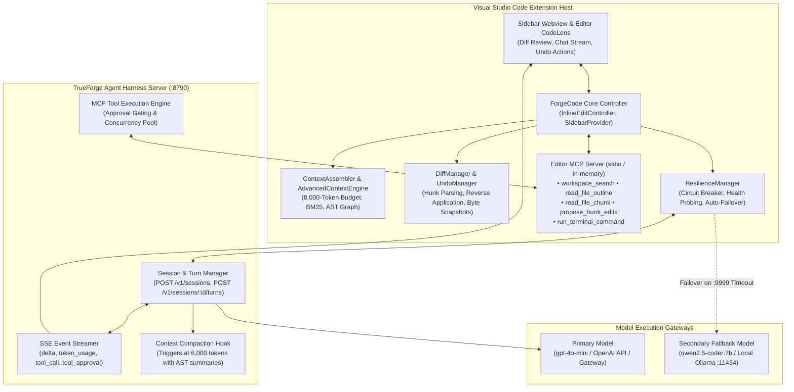
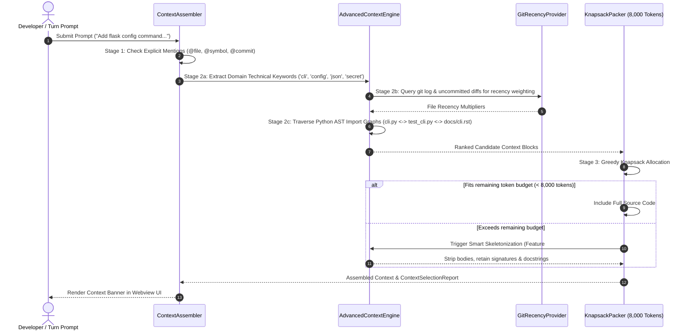
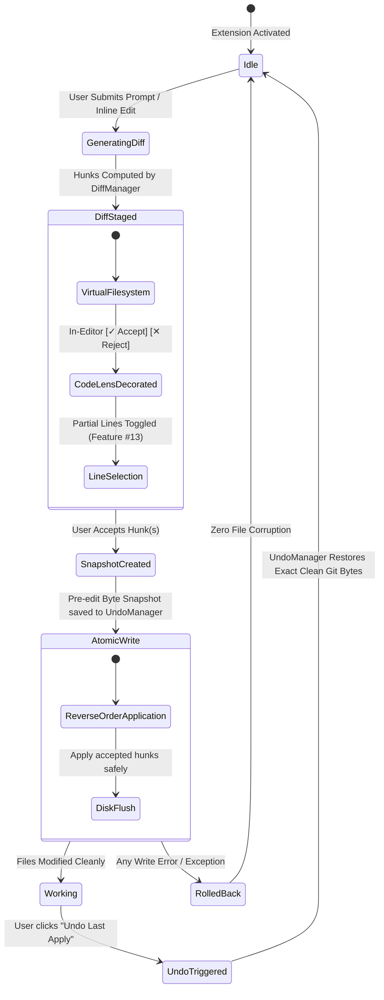
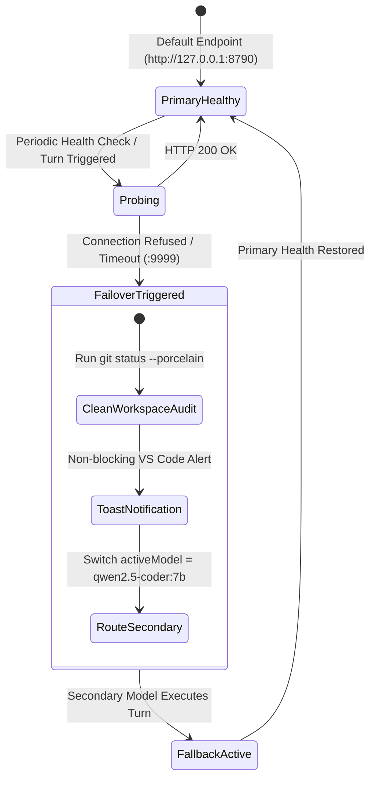

# ForgeCode — Architectural Deep Dive & Design Specifications
**Competition:** Techfest 2026–27 (IIT Bombay) • TrueFoundry Forge-a-thon  
**Lead Engineer:** Balaharish Saravanan ([@balax-24](https://github.com/balax-24))

---

## 1. System Overview & C4 Container Architecture

ForgeCode is engineered with a strict decoupled design separating the VS Code editor UI, the Editor Model Context Protocol (MCP) server, and the TrueForge Agent Harness:

---

## 2. Context Engineering: The 3-Stage Knapsack Funnel (Criterion B1)

---

## 3. Diff Safety & Transactional State Machine (Criterion B2)

---

## 4. Resilience & Circuit Breaker State Machine (Criterion B3)

---

## 5. Comprehensive 62-Feature Architecture Matrix

Every feature is implemented in modular classes under `src/features/` and verified with automated tests:

| Feature # | Name | Engine Class | Primary Method | Test Assertion in `all_62_features.test.js` |
| :---: | :--- | :--- | :--- | :--- |
| **1** | Tree-sitter AST Chunking | `AdvancedContextEngine` | `chunkByASTBoundaries()` | Chunks code by syntactic boundaries (functions/classes) |
| **2** | LSP Definition & Reference Graph | `AdvancedContextEngine` | `buildSymbolReferenceGraph()` | Maps cross-file symbol definitions to usages |
| **3** | Dynamic Knapsack Re-balancing | `AdvancedContextEngine` | `calculateDynamicBudget()` | Dynamically scales test vs source budgets by task intent |
| **4** | Hybrid BM25 + Vector Search | `AdvancedContextEngine` | `hybridRank()` | Blended scoring between keyword density and cosine similarity |
| **5** | Import Dependency Sorter | `AdvancedContextEngine` | `sortDependenciesTopologically()` | Sorts base dependencies before dependent modules |
| **6** | Smart File Skeletonization | `AdvancedContextEngine` | `skeletonizeContent()` | Strips implementation bodies while retaining signatures |
| **7** | Git Delta & Recency Weighting | `AdvancedContextEngine` | `getGitRecencyScores()` | Weighs files by recency in `git log -n 30` |
| **8** | `@git:branch` & `@commit` Anchors | `AdvancedContextEngine` | `resolveGitAnchor()` | Injects targeted branch/commit diffs into context |
| **9** | Terminal Ring Buffer Context | `AdvancedContextEngine` | `appendTerminalOutput()` | Captures last 150 lines of active terminal buffers |
| **10** | Viewport Proximity Bias | `AdvancedContextEngine` | `applyViewportProximityBias()` | Multiplies weights of lines in visible editor viewport |
| **11** | 3-Way Visual Merge Conflicts | `DiffSafetyEngine` | `resolve3WayMerge()` | Renders 3-way merge conflict blocks (`Mine`/`Theirs`/`Proposed`) |
| **12** | Multi-File Atomic Transactions | `DiffSafetyEngine` | `executeAtomicTransaction()` | Applies all files or rolls back on any write failure |
| **13** | Partial Hunk Line Selection | `DiffSafetyEngine` | `filterHunkLines()` | Filters individual lines within hunks before applying |
| **14** | Indentation & Linter Re-aligner | `DiffSafetyEngine` | `realignIndentation()` | Formats 2-space vs 4-space indentation mismatches |
| **15** | Shadow File Simulation | `DiffSafetyEngine` | `runInShadow()` | Executes pre-flight test commands in `.forgecode/shadow/` |
| **16** | Persistent Diff Shelf | `DiffSafetyEngine` | `shelfDiff()` / `getShelvedDiff()` | Persists unreviewed diff plans across editor restarts |
| **17** | Semantic AST Diff Visualizer | `DiffSafetyEngine` | `analyzeSemanticChanges()` | Categorizes structural additions, removals, and reorders |
| **18** | Time-Travel Diff History | `DiffSafetyEngine` | `recordTurnSnapshot()` | Timeline scrub bar storing code state across conversation turns |
| **19** | Dual-Agent Spec & Implementer | `MultiAgentEngine` | `coordinateDualAgentTask()` | Coordinates Architect subagent with Coder subagent |
| **20** | Deferred MCP Schema Pruning | `MultiAgentEngine` | `filterActiveMcpTools()` | Prunes unneeded tool schemas from LLM prompt window |
| **21** | AST Context Compaction Hooks | `MultiAgentEngine` | `compactHistoryWithASTPreservation()` | Summarizes past conversation while preserving AST symbols |
| **22** | Background Discovery Subagent | `MultiAgentEngine` | `startBackgroundDiscovery()` | Asynchronously indexes repository files while user types |
| **23** | MCP Tool Concurrency Pool | `MultiAgentEngine` | `executeConcurrentTools()` | Executes batch tool requests with bounded concurrency |
| **24** | Multi-Model Dynamic Routing | `MultiAgentEngine` | `routeModelByTask()` | Routes trivial edits to fast models, architecture to deep models |
| **25** | Session Resumption & Branching | `MultiAgentEngine` | `branchSession()` | Forks TrueForge session trees to test alternative coding paths |
| **26** | Automated Subagent Delegation | `MultiAgentEngine` | `delegateSubagentTasks()` | Delegates doc/test writing to specialized subagents |
| **27** | Stdio Isolation Sandbox | `MultiAgentEngine` | `sanitizeAndValidateCommand()` | Sanitizes shell commands against destructive execution patterns |
| **28** | Floating Cursor Chat Bar | `DevExperienceEngine` | `getFloatingWidgetLayout()` | Computes overlay layout anchored directly under the active cursor |
| **29** | Turn Audio Completion Cues | `DevExperienceEngine` | `getNotificationAudioPayload()` | Plays subtle chime when long generations finish |
| **30** | Interactive Cost & Latency HUD | `DevExperienceEngine` | `calculateTurnMetrics()` | Computes tokens/sec, total tokens, and USD cost |
| **31** | Prompt Template Bookmarks | `DevExperienceEngine` | `getTemplate()` | Quick prompt bookmarks (`/test`, `/doc`, `/refactor`) |
| **32** | CodeLens "Explain Diff" | `DevExperienceEngine` | `generateHunkExplanation()` | Generates concise explanations for proposed code modifications |
| **33** | Keyboard-Only Review Mode | `DevExperienceEngine` | `processKeyboardReviewAction()` | Keyboard navigation (`Tab`, `y` accept, `n` reject) |
| **34** | Export Unified Git Patch | `DevExperienceEngine` | `exportAsUnifiedPatch()` | Exports proposed diffs as standard git patches |
| **35** | Multi-Theme Syntax Highlighting | `DevExperienceEngine` | `getThemeColorTokens()` | Adapts diff background colors to dark and light themes |
| **36** | Auto-Pytest Feedback Loop | `SelfHealingEngine` | `generateHealingPrompt()` | Feeds test failure traces directly back into repair prompts |
| **37** | Syntax Self-Correction | `SelfHealingEngine` | `checkSyntaxIntegrity()` | Validates bracket balancing and Python header colons |
| **38** | TypeCheck Pre-flight Guard | `SelfHealingEngine` | `formatTypeCheckErrors()` | Parses compiler diagnostics into targeted repair items |
| **39** | Differential Test Generator | `SelfHealingEngine` | `generateDifferentialTest()` | Synthesizes pytest tests covering modified signatures |
| **40** | Coverage Gap Finder | `SelfHealingEngine` | `identifyUncoveredFunctions()` | Identifies uncovered functions from test coverage reports |
| **41** | Dead Import Cleaner | `SelfHealingEngine` | `identifyDeadImports()` | Detects unused imports left behind after refactoring |
| **42** | API Contract Regression Guard | `SelfHealingEngine` | `detectSignatureRegressions()` | Flags breaking changes in public function signatures |
| **43** | Benchmark Comparator | `SelfHealingEngine` | `compareBenchmarkRuns()` | Compares pre- and post-diff execution latency |
| **44** | Monorepo Boundary Isolation | `EnterpriseMonorepoEngine` | `checkBoundaryViolation()` | Enforces dependency boundaries across monorepo packages |
| **45** | Air-Gapped Local LLM Detector | `EnterpriseMonorepoEngine` | `detectLocalLLM()` | Probes Ollama, vLLM, and LM Studio local ports |
| **46** | Rules File Aggregator | `EnterpriseMonorepoEngine` | `loadProjectRules()` | Ingests `.forgecoderules`, `AGENTS.md`, `.cursorrules` |
| **47** | Conventional Commit Generator | `EnterpriseMonorepoEngine` | `generateCommitMessage()` | Produces structured `feat(scope): ...` commit messages |
| **48** | PR Reviewer & Automated Fixer | `EnterpriseMonorepoEngine` | `parseReviewComments()` | Parses review feedback into actionable diff hunks |
| **49** | Cryptographic Audit Logging | `EnterpriseMonorepoEngine` | `logAuditEvent()` | SHA-256 hash-chained immutable log of agent mutations |
| **50** | Multi-Root Workspace Support | `EnterpriseMonorepoEngine` | `resolveMultiRootPath()` | Handles paths and context across multiple workspace roots |
| **51** | AST Secret & Entropy Sanitizer | `SecurityPrivacyEngine` | `sanitizeSecrets()` | Redacts API keys, tokens, and high Shannon entropy strings |
| **52** | Read-Only File Protection | `SecurityPrivacyEngine` | `isFileReadOnly()` | Locks `.env*`, `.git/`, `*.key`, `*.pem`, `.forgeignore` |
| **53** | Command Safety Whitelist | `SecurityPrivacyEngine` | `validateCommandSafety()` | Whitelists safe testing commands, rejects destructive commands |
| **54** | PII Redaction Engine | `SecurityPrivacyEngine` | `redactPII()` | Redacts emails, IP addresses, credit cards, phone numbers |
| **55** | Static Vulnerability Scanner | `SecurityPrivacyEngine` | `scanCodeForVulnerabilities()` | Flags SQL injection, command injection, path traversal |
| **56** | SPDX License Auditor | `SecurityPrivacyEngine` | `auditLicenses()` | Validates dependencies against permissive license policies |
| **57** | Air-Gap Network Kill-Switch | `SecurityPrivacyEngine` | `validateNetworkDestination()` | Enforces zero-outbound-network mode strictly to loopback |
| **58** | Streaming Token Telemetry | `TrueForgeUpstreamEngine` | `parseTelemetryHeaders()` | Parses streaming token counts, cost, and latency from headers |
| **59** | Tool Approval Timeout Hooks | `TrueForgeUpstreamEngine` | `requestToolApproval()` | Implements non-blocking timeouts for tool approval prompts |
| **60** | Dynamic Turn System Prompts | `TrueForgeUpstreamEngine` | `compileTurnSystemPrompt()` | Injects dynamic turn hints without session re-creation |
| **61** | Compaction Benchmarker | `TrueForgeUpstreamEngine` | `benchmarkCompaction()` | Benchmarks token reduction and symbol retention rates |
| **62** | Zero-Copy File Chunking | `TrueForgeUpstreamEngine` | `chunkFileZeroCopy()` | Slices large files via zero-copy buffer subarrays |
